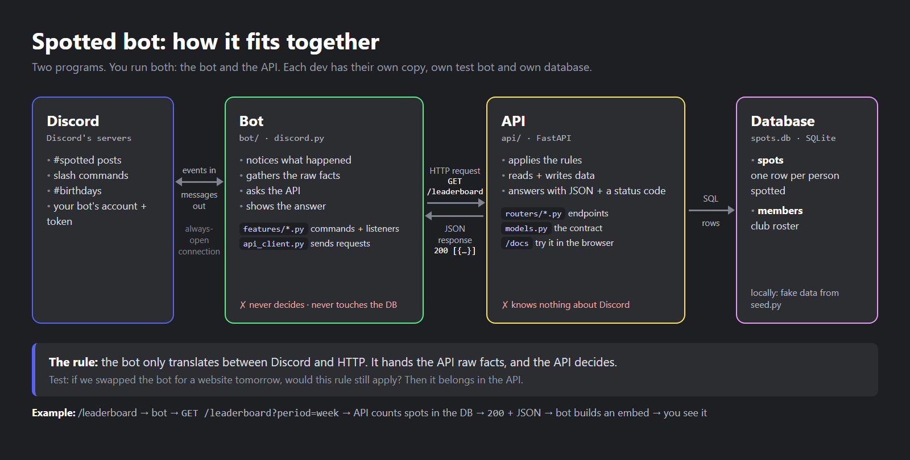
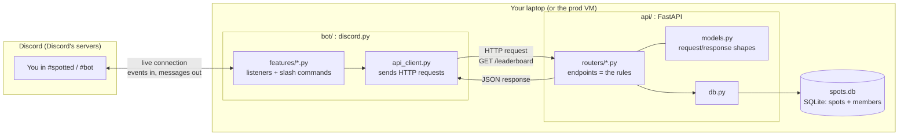
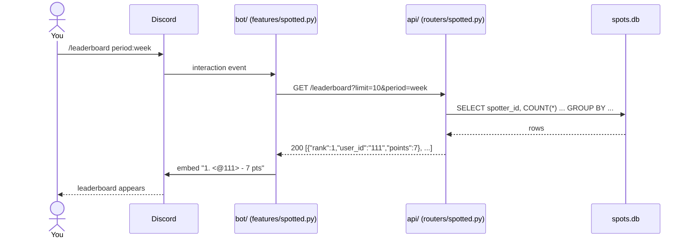
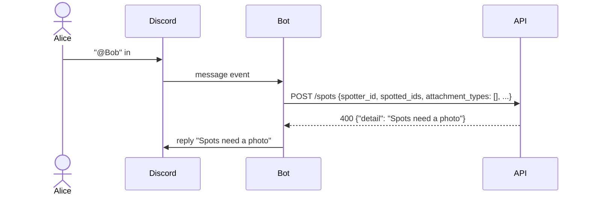

# How it works

Read this on day 1. It covers the big picture, what an API is, and how one command travels through the system.

## The big picture



The same thing in more detail:



There are **two separate programs**, and you run both:

| | `bot/` | `api/` |
|---|---|---|
| Library | discord.py | FastAPI |
| Talks to | Discord, and the API | the database |
| Job | notice what happened in Discord, ask the API, show the answer | apply the rules, read and write data, answer with JSON |
| Knows about | Discord: users, channels, embeds | spots, members, points |
| Never | decides anything or touches the database | knows Discord exists |

> **The rule:** the bot only translates between Discord and HTTP. It hands the API raw facts, and the API decides.
> Test: if we replaced the bot with a website tomorrow, would this rule still apply? If yes, it belongs in the API.

## What an API is

An **API** is a program that waits for **requests** and sends back **responses**. Ours speaks **HTTP**, the same thing your browser uses, and answers in **JSON**.

A request has:

| Part | Example | What it's for |
|---|---|---|
| **Method** | `GET`, `POST` | `GET` = read something. `POST` = create something. (Also `PUT`/`PATCH` = change, `DELETE` = remove.) |
| **Path** | `/users/123/stats` | *what* you want. Parts in `{braces}` in the code are **path parameters**: `/users/{discord_id}/stats` |
| **Query parameters** | `?limit=10&period=week` | options for the request, after the `?` |
| **Body** | `{"spotter_id": "111", ...}` | data you're sending, usually with `POST` |

A response has:

| Part | Example |
|---|---|
| **Status code** | `200 OK`, `201 Created`, `400 Bad Request`, `404 Not Found`, `409 Conflict`, `422 Unprocessable`, `500 Server Error`, `501 Not Implemented` |
| **Body** | `[{"rank": 1, "user_id": "111", "points": 7}]` |

Status codes are a **contract**. The caller reads the number to know what happened before it even looks at the body:

| Code | Meaning | In this project |
|---|---|---|
| 2xx | it worked | `200` read OK, `201` spot saved |
| 4xx | **the caller** did something wrong | `400` breaks a rule (no photo), `404` no such member, `409` message already counted, `422` malformed input (FastAPI sends this automatically) |
| 5xx | **the server** broke | `500` a bug in the API, `501` endpoint not built yet |

## How FastAPI turns a function into an endpoint

```python
@router.get("/leaderboard", response_model=list[LeaderboardEntry])   # method + path + response shape
def leaderboard(
    limit: int = 10,                                 # query parameter: ?limit=10
    db: sqlite3.Connection = Depends(get_db),        # "give me a database connection"
) -> list[LeaderboardEntry]:
    rows = db.execute("SELECT ... LIMIT ?", (limit,)).fetchall()
    return [LeaderboardEntry(...) for row in rows]   # FastAPI turns this into JSON
```

- The **decorator** (`@router.get(...)`) says which method and path run this function.
- **Parameters** become path params (if they're in the path), a request body (if they're a Pydantic model), or query params (everything else). FastAPI checks their types and sends `422` if they're wrong.
- `Depends(get_db)` is **dependency injection**: FastAPI opens a database connection before your function runs and closes it after.
- To send an error: `raise HTTPException(404, "Member not found")`.
- `api/models.py` holds the shapes of everything going in and out. That file is the contract between the bot and the API.

## How the bot calls the API

```python
resp = await api.get("/leaderboard", limit=10, period="week")   # GET /leaderboard?limit=10&period=week
resp = await api.post("/spots", json={"spotter_id": "111", ...})

resp.status_code   # 201
resp.json()        # {"points_awarded": 2}
```

`await` means "wait for the answer without freezing the bot", so it can keep handling other people's commands meanwhile. Always check `status_code` before using `resp.json()`.

## One command, start to finish



And a spot, where the API says no:



Notice the bot didn't check for the photo. It passed the facts along, and the API made the call.

## Where things live

```
api/main.py            starts FastAPI, GET /health (worked example)
api/models.py          the contract: shapes of requests and responses
api/db.py              database tables and connections
api/routers/*.py       endpoints (your TASK code goes here)
bot/main.py            connects to Discord, loads features
bot/api_client.py      api.get / api.post
bot/features/*.py      commands and listeners (your TASK code goes here)
tests/                 flow tests; `pytest` runs them
```

## Try it yourself

1. Run the API (`uvicorn api.main:app --reload`) and open http://127.0.0.1:8000/docs.
2. Open `GET /health` → **Try it out** → **Execute**. Look at the status code and JSON.
3. Try `POST /spots` with an empty body `{}`. You'll get `422`, because FastAPI rejected it before any code ran.
4. Run the bot and type `/ping`. That's the same `/health` request, sent by the bot instead of you.
